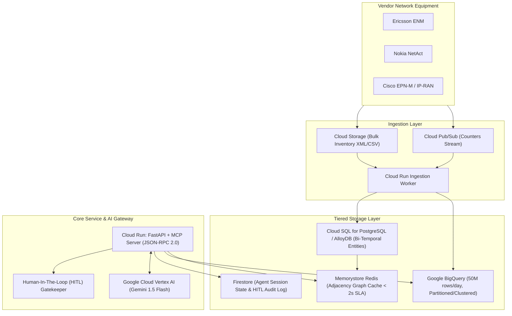

# Telecom Network Intelligence Platform for Role-Based AI Agents

[]()
[]()
[-success.svg)]()
[]()
[]()
[]()

> A production-grade telecommunications network intelligence platform providing **Connection Factory**, **KPI Engine**, **Bi-Temporal Topology Engine**, **Model Context Protocol (MCP)** tools, and **Role-Based Autonomous AI Agents** governed by strict **Human-In-The-Loop (HITL)** safeguards.

---

## 📋 Table of Contents
1. [Scenario & Business Problem (The 10:05 UTC Incident)](#-scenario--business-problem-the-1005-utc-incident)
2. [Key Platform Capabilities](#-key-platform-capabilities)
3. [Architecture Overview & Technology Choices](#-architecture-overview--technology-choices)
4. [Role-Based Access Control (RBAC) & Governance](#-role-based-access-control-rbac--governance)
5. [Quickstart Guide (Run Locally in 60 Seconds)](#-quickstart-guide-run-locally-in-60-seconds)
6. [Interactive Web Dashboard & Topology Console](#-interactive-web-dashboard--topology-console)
7. [Automated Test Suite](#-automated-test-suite)
8. [Comprehensive Documentation Index](#-comprehensive-documentation-index)
9. [Repository Structure](#-repository-structure)

---

## 🚨 Scenario & Business Problem (The 10:05 UTC Incident)

### The Event
At **10:05 UTC**, several cells (`CELL_001`, `CELL_002`, `CELL_003`) report availability alarms (0% availability) and degraded performance.

### The Autonomous Investigation Challenge
An **Alarm Management Agent** investigates:
1. **Which nodes, sites, and services are associated with the affected cells?**  
   $\rightarrow$ Discovers `CELL_001` & `CELL_002` are hosted on `NODE_42` (Ericsson), while `CELL_003` is on `NODE_43` (Nokia) at `SITE_ALPHA`.
2. **Do those entities share transport infrastructure or other dependencies?**  
   $\rightarrow$ The Topology Engine traverses upstream to reveal both nodes route backhaul through Cell Site Router `CSR_ALPHA_01` terminating on Primary Fiber Link `LINK_BACKHAUL_09`.
3. **What were their KPIs before and during the incident?**  
   $\rightarrow$ Pre-incident (09:45-10:00) showed 100% nominal availability. At 10:03 UTC, packet loss on `LINK_BACKHAUL_09` surged to **94.2%**, collapsing cell availability to 0%.
4. **Is the apparent degradation a network problem, missing data, or an unresolved uncertainty?**  
   $\rightarrow$ The KPI Engine evaluates counter completeness: `completeness_score = 1.0` (all 3 5-min samples present). The degradation is verified as a **GENUINE_NETWORK_PROBLEM** (physical optical backhaul failure), not a telemetry gap.
   *(In contrast, control cell `CELL_099` with missing telemetry receives a `DATA_GAP_OR_UNCERTAINTY` verdict, prompting the agent to halt and decline action).*
5. **What action should be recommended, and what evidence supports it?**  
   $\rightarrow$ The agent stages a remediation action: **Reroute backhaul traffic via Standby Microwave Link `LINK_BACKHAUL_STANDBY_09`** into `PENDING_APPROVAL` status. A **Human NOC Lead** inspects the blast radius and authorizes execution.

---

## ⚙️ Key Platform Capabilities

### 1. Connection Factory
- Collects inventory, configuration, and performance telemetry from heterogeneous vendors (**Ericsson ENM**, **Nokia NetAct**, **Cisco EPN-M**).
- Normalizes vendor-specific counters (`pmCellDowntimeAuto`, `cell_unavailable_time`, `ifOutDiscards`) to canonical 3GPP metrics.
- Preserves **SHA-256 content hashes**, lineage, and ingestion timestamps.
- Resolves conflicts using deterministic source authority rankings (`Ericsson_ENM (100) > Passive_Scanner (40)`).

### 2. KPI Engine
- Computes standard 3GPP KPIs across **15-minute sliding windows** with division-by-zero protection.
- Supports **late-arriving data up to 2 hours** with sliding watermarks and incremental delta recalculations (bumping revision and setting `is_recalculated=True`).
- Attaches data quality flags (`COMPLETE`, `PARTIAL_ESTIMATED`, `INCOMPLETE`, `NO_DATA`) to distinguish real outages from reporting silence.

### 3. Topology Engine
- **Bi-Temporal Graph Model**: Tracks `valid_time` (real-world truth) and `system_time` (platform transaction time) to answer: *"What did the network topology look like at 10:05 UTC when the alarm fired?"*
- Bounded k-hop neighbor traversals with **sub-2.0s p95 latency guarantee**.
- Common ancestor correlation to detect shared transport and site bottlenecks.

---

## 🏗️ Architecture Overview & Technology Choices



---

## 🔒 Role-Based Access Control (RBAC) & Governance

The platform strictly enforces the **Principle of Least Privilege** across four distinct operational roles:

| Operational Role | Topo Read | KPI Read | KPI Recalc | Propose Action | Approve / Execute | Intended Boundary |
| :--- | :---: | :---: | :---: | :---: | :---: | :--- |
| **Alarm Management Agent** | ✅ | ✅ | ❌ | ✅ | ❌ | Investigate alarms, correlate evidence, stage incident fixes. |
| **Performance Analysis Agent** | ✅ | ✅ | ✅ | ❌ | ❌ | Investigate KPI trends, detect anomalies across slices. |
| **Change Planning Agent** | ✅ | ✅ | ❌ | ✅ | ❌ | Assess blast radius, simulate failovers, prepare change briefs. |
| **Human Operator (NOC Lead)** | ✅ | ✅ | ✅ | ✅ | **✅ (HITL)** | Authorize production changes and oversee AI actions. |

---

## 🚀 Quickstart Guide (Run Locally in 60 Seconds)

### Step 1: Clone and Install Dependencies
```bash
# Clone the repository
git clone https://github.com/your-org/network-intelligence-platform.git
cd network-intelligence-platform

# Install dependencies (Python 3.11+ recommended)
pip install -r requirements.txt
```

### Step 2: Run the Standalone CLI Incident Demo
Experience the full 10:05 UTC incident investigation directly in your terminal:
```bash
python scripts/run_demo.py
```

### Step 3: Launch the Interactive Web Platform & API Server
```bash
python -m app.main
```
Navigate to **http://localhost:8000** in your web browser.

---

## 🖥️ Interactive Web Dashboard & Topology Console

The web UI provides an operations console:
- **Bi-Temporal Topology Visualizer**: SVG canvas illustrating Site Alpha, Node 42/43, Cells 001-003, CSR Alpha 01, Failing Primary Fiber (flashing red), and Standby Microwave (amber).
- **Agent Investigation Trace Console**: Live execution trace of the Alarm Management Agent detailing phase type (`[DETERMINISTIC_TOOL]` vs `[LLM_SYNTHESIS]`), tool invoked, and duration.
- **KPI Engine & Evidence Quality Table**: Displays 15-minute sliding metrics with completeness badges (100% vs 33% on control cell).
- **Human-In-The-Loop Approval Gate**: Interactive buttons to **Approve & Execute Reroute** or **Reject Proposal** with audit logging.

---

## 🧪 Automated Test Suite

The platform includes a test suite covering all functional and non-functional requirements:
```bash
python scripts/run_tests.py
```

### Test Coverage Summary:
- `test_connection_factory.py`: Multi-vendor normalization (Ericsson, Nokia, Cisco), content hashing, deduplication, and authority conflict resolution.
- `test_topology_temporal.py`: Bi-temporal point-in-time snapshot as of 10:05 UTC, bounded 2-hop traversal (<2s SLA), and shared dependency correlation.
- `test_kpi_engine.py`: 15-minute window rollups, late-arriving data incremental recalculation, completeness scoring, and distinguishing real outages from missing data.
- `test_security_rbac.py`: Multi-tenant isolation across 5 customers, cross-tenant relationship rejection, role permission boundaries, and HITL lifecycle.
- `test_mcp_tools.py`: Model Context Protocol JSON-RPC schema compliance and role authorization.
- `test_agent_investigation.py`: End-to-end 10:05 UTC incident simulation, SLA verification (<30s), and uncertainty rejection testing.

---

## 📚 Comprehensive Documentation Index

For deep architectural and implementation details, refer to the documentation in `/docs`:
- [`01_SYSTEM_ARCHITECTURE.md`](docs/01_SYSTEM_ARCHITECTURE.md): End-to-end flow, synchronous vs events vs batch, GCP compute & storage choices, cost & latency trade-offs, evidence triggers.
- [`02_TOPOLOGY_DATA_MODEL.md`](docs/02_TOPOLOGY_DATA_MODEL.md): Bi-temporal data model (`valid_time` vs `system_time`), reconciliation engine, entity-to-KPI linkage.
- [`03_KPI_ENGINE_DATA_QUALITY.md`](docs/03_KPI_ENGINE_DATA_QUALITY.md): 15-min aggregation windows, late data watermarking (2 hours), formula registry, evidence integrity.
- [`04_API_MCP_SPECIFICATION.md`](docs/04_API_MCP_SPECIFICATION.md): REST API & Model Context Protocol specification, JSON-RPC schemas, query bounds, HITL approval state machine.
- [`05_AGENT_DESIGN_EVALUATION.md`](docs/05_AGENT_DESIGN_EVALUATION.md): Incident walkthrough, deterministic vs LLM boundaries, multi-agent rationale, stopping conditions, continuous evaluation harness.
- [`06_EXECUTIVE_SLIDES.md`](docs/06_EXECUTIVE_SLIDES.md): 5-slide executive presentation covering platform vision, architecture, governance, and incident resolution.
- [`07_ASSUMPTIONS_AND_QUESTIONS.md`](docs/07_ASSUMPTIONS_AND_QUESTIONS.md): Explicit assumptions, architectural challenges (MOCN, burst traffic), and open questions for stakeholders.

---

## 📁 Repository Structure

```
nw_intelligence/
├── README.md                      # Master Guide & Project Summary
├── pyproject.toml                 # Standard Python Build Configuration
├── requirements.txt               # Pinned Python Dependencies
├── Dockerfile                     # Production Container for Cloud Run
├── docs/                          # Detailed Technical Architecture Docs
│   ├── 01_SYSTEM_ARCHITECTURE.md
│   ├── 02_TOPOLOGY_DATA_MODEL.md
│   ├── 03_KPI_ENGINE_DATA_QUALITY.md
│   ├── 04_API_MCP_SPECIFICATION.md
│   ├── 05_AGENT_DESIGN_EVALUATION.md
│   ├── 06_EXECUTIVE_SLIDES.md
│   └── 07_ASSUMPTIONS_AND_QUESTIONS.md
├── app/                           # Core Application Package
│   ├── main.py                    # Entrypoint (FastAPI + MCP + Web Console)
│   ├── config.py                  # Environment & GCP Settings
│   ├── connection_factory/        # Capability 1: Normalizer, Validator, Provenance
│   ├── kpi_engine/                # Capability 2: Calculator, Quality Analyzer, Models
│   ├── topology_engine/           # Capability 3: Bi-Temporal Graph, Bounded BFS Traversal
│   ├── security/                  # Multi-Tenancy & RBAC Governance
│   ├── mcp/                       # Model Context Protocol JSON-RPC Server & Tools
│   ├── agents/                    # Role-Based Agents (Alarm, Change, Orchestrator, HITL)
│   ├── api/                       # REST API Endpoints & Pydantic Schemas
│   └── static/                    # Frontend UI (index.html, styles.css, app.js)
├── data/
│   └── seed_data.py               # Multi-Tenant Incident Telemetry Generator
├── tests/                         # Unit & Integration Test Suite (19 tests)
└── scripts/
    ├── run_demo.py                # Standalone CLI Incident Demo
    └── run_tests.py               # Automated Test Runner
```

