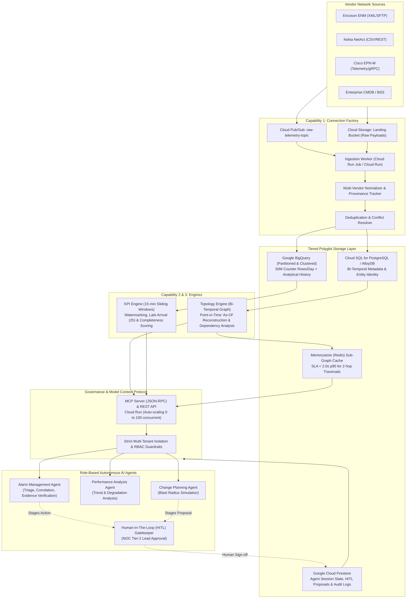

# 01. System Architecture & Technology Choices

## 1. Executive Summary & Architecture Overview

The Telecom Network Intelligence Platform is an enterprise-grade operational backbone designed for **five isolated telecommunication customers**, managing over **25,000 radio nodes**, **250,000 cells**, and **2,000,000 topological relationships**, ingesting **50,000,000 raw performance counter rows daily**.

The platform powers role-governed autonomous AI agents that investigate real-time incidents (such as cell degradation at 10:05 UTC), correlate shared transport and site dependencies, evaluate evidence integrity, and stage human-authorized remediations.

---

## 2. Ingestion, Storage & Processing Flow

### A. Synchronous Requests vs. Events vs. Batch Processing

| Flow Pattern | Mechanism | Technology | Rationale & Workload |
| :--- | :--- | :--- | :--- |
| **Event-Driven Streaming** | Asynchronous Event Streams | Cloud Pub/Sub + Cloud Run | High-priority alarms, interface state changes, and streaming Cisco gRPC counters. Immediate ingestion without buffering delay. |
| **Micro-Batch Ingestion** | 15-Minute Scheduled Micro-Batches | Cloud Run Services + Eventarc | 50M performance counters arrive in bursts at 15-minute boundaries. Micro-batching amortizes database transaction overhead and aligns with 3GPP standards. |
| **Batch Bulk Updates** | Hourly Scheduled Batch Jobs | Cloud Run Jobs / Dataproc Serverless | Bulk inventory dumps from vendor OSS/NMS (Ericsson ENM / Nokia NetAct), reconciling passive CMDB records. |
| **Synchronous Queries** | Request-Response RPC | Cloud Run (FastAPI + MCP) | Agent investigations requiring < 2s bounded topology lookups and real-time evidence integrity checks. |

---

## 3. Google Cloud Compute & Runtime Selection

For a small engineering team, **operational overhead and maintenance burden must be minimized**. 

### Why Cloud Run and Cloud Run Jobs over GKE?
- **Zero Cluster Management**: GKE requires continuous control plane maintenance, node pool scaling, VPC CNI management, and Kubernetes security patch cycles.
- **Scale to Zero**: Network incidents and agent investigations are bursty. Cloud Run scales from 0 instances during quiescent periods up to 100+ concurrent agent investigations within 2 seconds.
- **Cloud Run Jobs for Batch Ingestion**: Bulk inventory imports and hourly Dataform/dbt runs execute cleanly as serverless Cloud Run Jobs, terminating upon completion and incurring zero idle cost.
- **When would we migrate to GKE?** If ingestion exceeds 500,000 events/second sustained, or if custom network kernels/gRPC streaming proxies are required that exceed Cloud Run's 60-minute execution boundary.

---

## 4. Tiered Storage Architecture & Technology Trade-offs

| Storage Technology | Platform Role | Query Patterns & SLA | Operational Effort & Cost |
| :--- | :--- | :--- | :--- |
| **Google BigQuery** | Counter Data Lake & Historical Analytical KPIs (50M rows/day) | Analytical aggregations over 15m, 1h, 24h. Partitioned by `DATE(timestamp)` and `customer_id`; clustered by `entity_id`. | **Zero ops**. Extremely cost-effective for analytical burst queries via BigQuery BI Engine. |
| **Cloud SQL for PostgreSQL / AlloyDB** | Master Entity Metadata & Bi-temporal Transaction Store | Point-in-time entity lookups and ACID inventory reconciliation. | Managed backups, automatic failover. Low operational burden. |
| **Memorystore (Redis) / In-Memory Graph** | 2-Hop Topology Adjacency Cache | Bounded BFS graph queries. Guarantees **< 2.0s p95 SLA** for agent topology neighborhood queries. | Fully managed in-memory cache with sub-millisecond read latency. |
| **Google Cloud Firestore** | Agent State, Session Context, HITL Proposals & Audit Logs | Document-oriented transactional state for active agent investigations. | Serverless, multi-region replication, native optimistic concurrency. |

---

## 5. Architectural Evaluation & Triggers for Design Evolution

| System Area | Initial MVP Choice | Evidence Trigger to Evolve | Evolution Target |
| :--- | :--- | :--- | :--- |
| **Graph Traversal** | AlloyDB / Cloud SQL with Redis Adjacency Cache | 2-hop traversal p95 latency exceeds 1.5 seconds, or graph depth requirements expand beyond 3 hops. | **Google Cloud Spanner Graph** or **Neo4j AuraDB Enterprise**. |
| **KPI Stream Ingestion** | Cloud Run Micro-batchers | 15-minute counter bursts cause HTTP ingest throttling, or late-arriving data volume exceeds 20% of total payload. | **Managed Apache Beam on Google Cloud Dataflow** with tumbling/sliding event-time watermarking. |
| **Agent Reasoning** | Vertex AI (Gemini 2.0 Flash) with deterministic tool scaffolding | Agent hallucination rate on root cause synthesis exceeds 1.0%, or tool selection precision drops below 95%. | Hybrid Fine-Tuned Domain Model + Multi-Agent Consensus Verification. |

