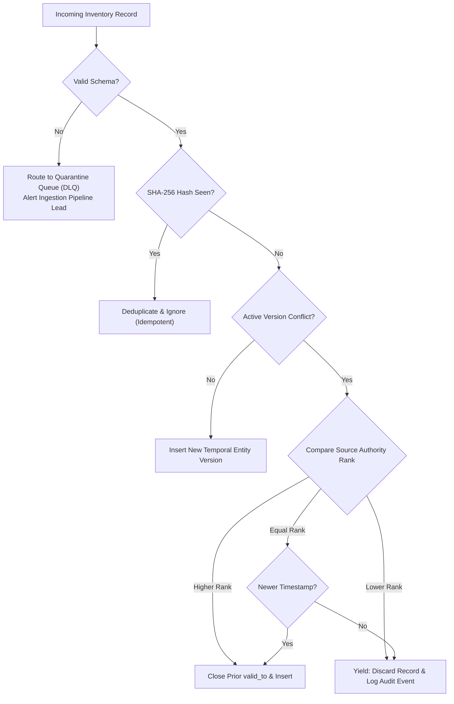

# 02. Inventory & Topology Data Model

## 1. Bi-Temporal Modeling Framework

A critical requirement of telecommunications incident root cause analysis is answering:  
> **"What did the network topology look like at the exact moment this alarm occurred (10:05 UTC)?"**

Traditional databases overwrite state on updates, destroying historical visibility. Our platform implements a **Bi-Temporal Data Model** separating **Valid Time** (when a fact was physically true in the real world) from **System Time** (when the platform learned of that fact).

```mermaid
gantt
    title Bi-Temporal Event Timeline (10:05 UTC Incident)
    dateFormat HH:mm
    axisFormat %H:%M
    
    section Physical Reality (Valid Time)
    Cell 001 Active on Primary Link       :09:00, 10:03
    Backhaul Degradation & Alarm Trigger  :crit, 10:03, 10:15
    Microwave Standby Reroute Active      :active, 10:15, 11:00
    
    section Ingestion Pipeline (System Time)
    Normal Telemetry Processed            :09:45, 10:00
    Incident Alarms Ingested              :crit, 10:05, 10:06
    Late Vendor Topology Update Arrives   :done, 10:35, 10:36
    Historical Re-calculation Triggered   :active, 10:36, 10:37
```



### Entity Schema Attributes

Every network entity (Cell, Node, Site, Router, Link) and relationship record includes four temporal coordinates:

```sql
CREATE TABLE network_entity_versions (
    entity_id           VARCHAR(128) NOT NULL,
    tenant_id           VARCHAR(64)  NOT NULL,
    entity_type         VARCHAR(32)  NOT NULL,
    vendor              VARCHAR(32)  NOT NULL,
    properties          JSONB        NOT NULL,
    
    -- Real-world validity period
    valid_from          TIMESTAMPTZ  NOT NULL,
    valid_to            TIMESTAMPTZ,             -- NULL indicates currently valid
    
    -- Platform transaction / ingestion period
    system_from         TIMESTAMPTZ  NOT NULL DEFAULT CURRENT_TIMESTAMP,
    system_to           TIMESTAMPTZ,             -- NULL indicates current knowledge
    
    provenance_hash     VARCHAR(64)  NOT NULL,
    ingestion_batch_id  VARCHAR(64)  NOT NULL,
    PRIMARY KEY (entity_id, valid_from, system_from)
);
```

### Point-in-Time Temporal Query Semantics
To reconstruct the exact graph state at `10:05:00 UTC`:
```sql
SELECT * FROM network_entity_versions
WHERE tenant_id = 'customer_a'
  AND valid_from <= '2026-11-10T10:05:00Z'
  AND (valid_to IS NULL OR valid_to > '2026-11-10T10:05:00Z')
  AND system_from <= CURRENT_TIMESTAMP
  AND (system_to IS NULL OR system_to > CURRENT_TIMESTAMP);
```

---

## 2. Inventory Reconciliation & Conflict Resolution

Inventory records arrive from disparate vendor systems (Ericsson ENM, Nokia NetAct, Cisco EPN-M) and enterprise CMDBs. The platform applies deterministic reconciliation:



### Source Authority Priority Matrix
When conflicting records arrive for the same physical entity:
1. **Vendor Authoritative EMS (Ericsson ENM / Nokia NetAct / Cisco EPN)**: Weight = 100
2. **Enterprise CMDB / BSS**: Weight = 90
3. **SNMP Collector / Active Prober**: Weight = 60
4. **Passive Topology Crawler**: Weight = 40

Unresolvable conflicts (e.g. identical rank and identical timestamp but conflicting properties) are never discarded silently; they are staged in a **Quarantine Dead Letter Queue** with audit notifications.

---

## 3. Entity-to-KPI Linkage Architecture

Entities in the topology engine link to performance metrics in BigQuery via **Global Canonical URNs (Uniform Resource Names)**:
- Standard 3GPP Cell Format: `urn:3gpp:network:{tenant_id}:cell:{cell_id}`
- Cell Site Router: `urn:ietf:network:{tenant_id}:router:{router_id}`
- Transport Link: `urn:ietf:network:{tenant_id}:link:{link_id}`

In BigQuery, performance tables are partitioned by `DATE(timestamp)` and clustered by `(tenant_id, canonical_urn)`:
```sql
SELECT 
    k.timestamp,
    k.kpi_name,
    k.value,
    k.quality_status,
    k.completeness_score
FROM `telecom_kpis.kpi_rollups_15m` k
WHERE k.tenant_id = 'customer_a'
  AND k.entity_urn = 'urn:3gpp:network:customer_a:cell:CELL_001'
  AND k.timestamp BETWEEN '2026-11-10T09:30:00Z' AND '2026-11-10T10:15:00Z';
```
This guarantees sub-second BigQuery execution while preserving full provenance back to source vendor payloads.

