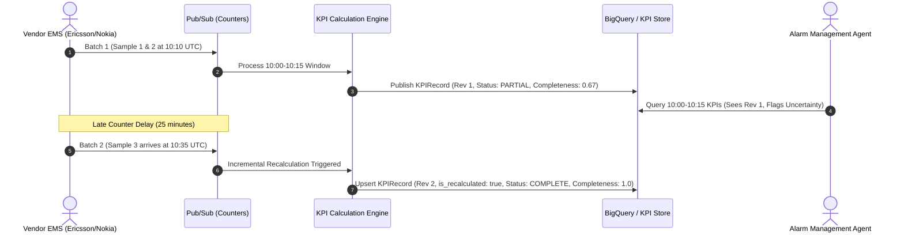
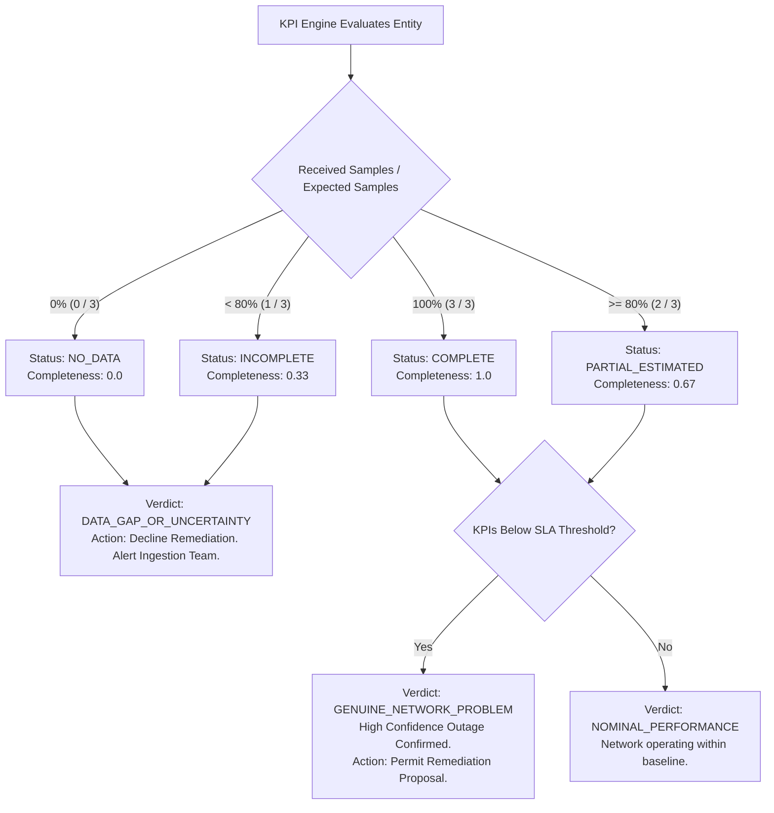

# 03. KPI Engine & Data Quality Specification

## 1. 15-Minute Reporting Windows & Aggregation Mechanics

Telecommunication networks generate performance counters aligned to standard **15-minute 3GPP measurement periods** (e.g. 10:00–10:15 UTC). Raw telemetry counters are received at finer 1-minute or 5-minute sub-intervals.

The KPI Engine performs tumbling window aggregations with:
1. **Division-by-zero protection**: Guarding against empty traffic windows where connection attempts equal zero.
2. **Formula Registry & Versioning**: Every computed metric logs its formula version (e.g. `v1.2`) to support non-breaking formula updates.
3. **Audit Provenance**: Every KPI links to the exact set of raw counter hashes that produced it.

---

## 2. Core 3GPP & Transport KPI Formulas

| KPI Name | Formula | Unit | Required Raw Counters |
| :--- | :--- | :---: | :--- |
| **CELL_AVAILABILITY** | `100 * (1 - (cell_downtime_seconds / 900))` | `%` | `cell_downtime_seconds` |
| **RADIO_DROP_RATE** | `100 * (erab_drops / (erab_drops + erab_releases))` | `%` | `erab_abnormal_drops`, `erab_normal_releases` |
| **PRB_UTILIZATION_DL** | `100 * (prb_used_dl / prb_available_dl)` | `%` | `prb_used_dl`, `prb_available_dl` |
| **RRC_SETUP_SUCCESS** | `100 * (rrc_succ / rrc_attempts)` | `%` | `rrc_connection_attempts`, `rrc_connection_successes` |
| **TRANSPORT_PACKET_LOSS** | `100 * (discards / (packets_est + discards))` | `%` | `packet_discards_out`, `octets_out` |

---

## 3. Late-Arriving Data & Incremental Recalculation

Performance counters may arrive up to **2 hours late** due to transport buffering, backhaul congestion, or vendor EMS collector delays.

### Watermark Specification
- **Window Close Time**: $T_W + 15\text{ minutes}$
- **Sliding Watermark Grace Period**: $T_W + 135\text{ minutes}$ (2 hours 15 minutes)
- When a counter sample arrives with timestamp $T \le \text{Watermark}$, the engine performs an **incremental upsert**:
  1. Merges new counters into existing window sums.
  2. Increments `sample_count` and updates `completeness_score`.
  3. Increments record `revision` (e.g. $1 \rightarrow 2$).
  4. Sets `is_recalculated = true`.

---

## 4. Evidence Integrity: Outage vs. Missing Data

A primary risk in autonomous operations is an AI agent mistaking **missing telemetry for a catastrophic network crash** (or vice versa).

### Governance Rule for AI Agents
- **Rule 1 (Confidence Threshold)**: Autonomous agents are strictly prohibited from proposing remediation actions if entity `completeness_score < 0.80` or if `quality_status == INCOMPLETE`.
- **Rule 2 (Distinguishing Case)**: In our 10:05 UTC incident:
  - `CELL_001`, `CELL_002`, `CELL_003` report **100% counter completeness** $\rightarrow$ Confirmed **Genuine Network Problem**.
  - Control cell `CELL_099` reports **33% counter completeness** $\rightarrow$ Confirmed **Telemetry Gap / Uncertainty**. Agent halts and declines network reroute.

