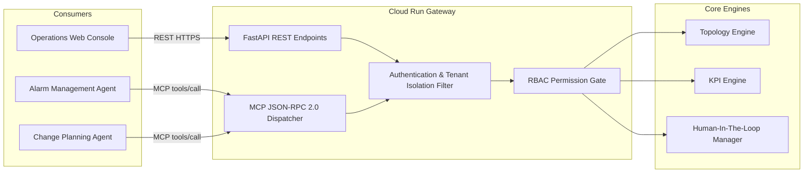
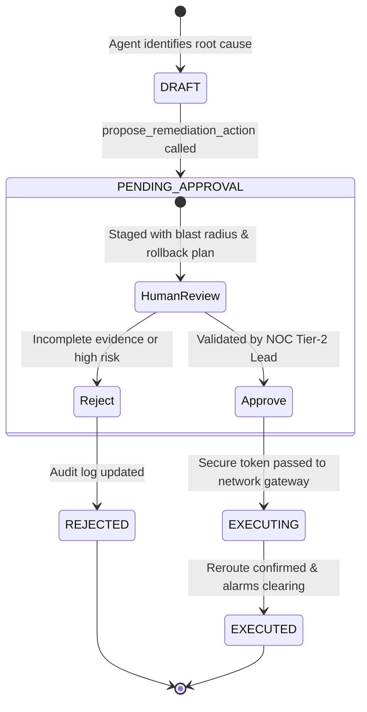

# 04. API & Model Context Protocol (MCP) Specification

## 1. API and MCP Architecture Relationship

The platform exposes dual interfaces with shared underlying governance and security layers:
1. **REST API (OpenAPI 3.0)**: Used by human dashboards, NOC automation workflows, and microservices for standard CRUD operations and scheduled jobs.
2. **Model Context Protocol (MCP) JSON-RPC 2.0**: Exposes bounded tools directly to AI Agents (Gemini, Claude, local models). Enforces structured JSON schemas, tool filtering by caller role, and token-bounded payloads.



---

## 2. Model Context Protocol Tools Specification

| Tool Name | Intended Role | Description | Parameters & Bounds |
| :--- | :--- | :--- | :--- |
| `get_topology_neighborhood` | Alarm, Perf, Change | Bounded k-hop neighborhood around entity as of timestamp. | `entity_id` (str), `as_of_time` (ISO), `max_hops` (int, 1-3). SLA < 2s. |
| `find_shared_dependencies` | Alarm, Change | Upstream common ancestors (shared CSR, backhaul link, site). | `entity_ids` (array[str]), `as_of_time` (ISO). Cutoff 3 hops. |
| `get_entity_kpis` | Alarm, Perf, Change | Time-series KPIs with completeness scores & formula version. | `entity_id` (str), `start_time` (ISO), `end_time` (ISO). |
| `verify_evidence_integrity` | Alarm, Perf | Verifies whether degradation is genuine outage vs missing data. | `entity_ids` (array[str]), `start_time` (ISO), `end_time` (ISO). |
| `propose_remediation_action`| Alarm, Change | Stages proposal in `PENDING_APPROVAL`. Does NOT execute directly. | `target_entity_id`, `action_type`, `justification`, `blast_radius`, `rollback`. |
| `approve_action` | Human Operator only | Authorizes and executes staged remediation on production. | `action_id`, `caller_id`, `comment`. |

---

## 3. Example Request & Response Contract

### A. Example MCP Tool Call: `find_shared_dependencies`

#### Request Payload (JSON-RPC 2.0)
```json
{
  "jsonrpc": "2.0",
  "id": "req-101",
  "method": "tools/call",
  "params": {
    "name": "find_shared_dependencies",
    "arguments": {
      "entity_ids": ["CELL_001", "CELL_002", "CELL_003"],
      "as_of_time": "2026-11-10T10:05:00Z"
    }
  }
}
```

#### Response Payload (with Identity, Lineage & SLA Metadata)
```json
{
  "jsonrpc": "2.0",
  "id": "req-101",
  "isError": false,
  "result": {
    "queried_entities": ["CELL_001", "CELL_002", "CELL_003"],
    "as_of": "2026-11-10T10:05:00Z",
    "shared_count": 2,
    "shared_dependencies": [
      {
        "id": "CSR_ALPHA_01",
        "name": "Cell Site Router Alpha-01",
        "entity_type": "router",
        "vendor": "Cisco",
        "properties": {
          "model": "ASR-903",
          "ip_address": "10.200.1.1",
          "role": "IP_RAN_CSR"
        }
      },
      {
        "id": "LINK_BACKHAUL_09",
        "name": "Primary Fiber Backhaul 10G-09",
        "entity_type": "transport_link",
        "vendor": "Cisco",
        "properties": {
          "medium": "SingleMode_Fiber",
          "capacity_gbps": 10.0,
          "status": "ACTIVE_PRIMARY"
        }
      }
    ],
    "latency_ms": 0.85,
    "sla_met": true
  },
  "meta": {
    "caller_id": "alarm-agent-01",
    "role": "alarm_management",
    "tenant_id": "customer_a",
    "duration_ms": 1.12
  }
}
```

---

## 4. Query Bounds, Execution Limits & Safety Guards

To prevent unbounded graph traversals, LLM context overflow, and cloud budget exhaustion, the following strict bounds are enforced in code:

1. **Hop Depth Cutoff**: Hard limit of **3 hops** (default 2). Any request specifying `max_hops > 3` is clamped to 3.
2. **Entity Response Limit**: A maximum of **250 entities** per topology neighborhood query. If a subgraph exceeds 250 nodes, the result is truncated and flagged with `truncated: true`.
3. **Execution Timeout**: MCP tool dispatchers enforce a **2.0-second timeout** for topology lookups and **5.0-second timeout** for KPI queries.
4. **Token Budgeting**: JSON-RPC outputs are serialized with strict schemas, stripping extraneous vendor debug fields to keep context size under **2,000 tokens per tool call**.

---

## 5. Human-In-The-Loop (HITL) Action Lifecycle



