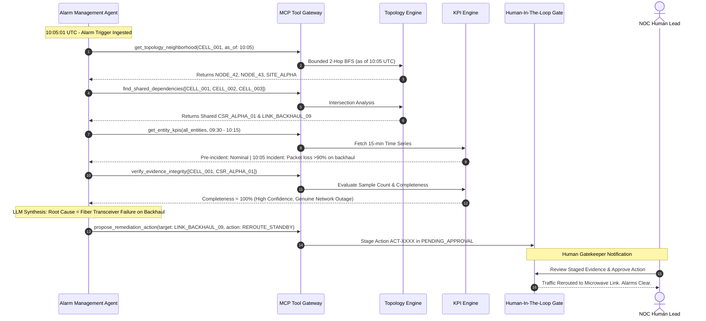

# 05. Agent Behaviour, Safety & Evaluation Framework

## 1. Walkthrough: The 10:05 UTC Incident Investigation

At **10:05:00 UTC**, alarms fire on `CELL_001`, `CELL_002`, and `CELL_003` (Availability = 0%, RRC Success = 0%).  
The Alarm Management Agent autonomously initiates an investigation:

---

## 2. Deterministic Logic vs. LLM Reasoning Boundaries

To guarantee safety, predictability, and sub-30-second response times, we strictly divide tasks:

| Platform Task | Execution Mode | Justification |
| :--- | :--- | :--- |
| **Topology Graph Traversal** | **Deterministic (Python / NetworkX / SQL)** | Graph traversal requires mathematical correctness and exact neighbor discovery. LLMs hallucinate node connections. |
| **KPI Calculation & Quality Scoring** | **Deterministic (Python / BigQuery)** | Statistical rollups, divisions, and percentage calculations must be bit-exact and audit-compliant. |
| **RBAC & Multi-Tenant Enforcement** | **Deterministic Guardrail (Python Context)** | Access control must never rely on prompt engineering or LLM goodwill. |
| **Tool Selection & Sequence Execution** | **Scaffolded State Machine / ReAct** | Deterministic state machine handles the standard 5-step triage sequence; LLM selects exploratory tools when anomalies diverge. |
| **Multi-Source Evidence Synthesis** | **LLM Reasoning (Gemini 1.5 Flash)** | Synthesizing unstructured syslog messages, vendor-specific alarms, and numerical telemetry into a coherent root cause narrative. |
| **Remediation Plan Formulation** | **LLM Formulation + Deterministic Schema** | Drafting human-readable justification, blast radius explanation, and rollback instructions adhering to strict Pydantic models. |

---

## 3. Single-Agent vs. Multi-Agent Rationale

We selected a **Role-Based Multi-Agent Architecture** with distinct agent personas:
1. **Alarm Management Agent**: Optimised for rapid incident triage, correlation, and proposing immediate fixes.
2. **Performance Analysis Agent**: Optimised for long-term trend analysis, baseline deviation detection, and capacity planning.
3. **Change Planning Agent**: Optimised for pre-change simulation, blast radius calculation, and risk scoring.

### Why not a single monolithic agent?
- **Principle of Least Privilege**: The Alarm Management Agent needs permission to propose operational reroutes, whereas the Performance Analysis Agent should **never** have write permissions. A monolithic agent risks permission escalation.
- **Context Window Pollution**: Combining 2-hop topology graphs, long-range 30-day KPI trends, and change calendar schemas into a single prompt blows through LLM token budgets and slows response times.
- **Independent Testing & Validation**: Each role can be evaluated against dedicated benchmark datasets.

---

## 4. Stopping Conditions & Declining Recommendations

The platform enforces explicit stopping conditions where agents **must halt and decline to recommend network actions**:

1. **Incomplete Evidence Gate**: If `completeness_score < 0.80` or telemetry status is `INCOMPLETE` / `NO_DATA` (demonstrated by our control cell `CELL_099`), the agent halts with verdict `DATA_GAP_OR_UNCERTAINTY`.
2. **Conflicting Signals Gate**: If cell availability is down but transport packet loss is 0% and radio alarms are absent, the agent stops and requests manual field probe inspection.
3. **Redundancy Absence Gate**: If the Change Planning Agent discovers that a proposed failover entity has no standby capacity (or standby link is also degraded), it declines to propose automated rerouting and escalates to emergency human dispatch.

---

## 5. Evaluation Framework & Golden Test Suite

We evaluate the platform using a **Continuous Evaluation Harness**:
1. **Golden Dataset**: 100 historical curated telecom network incidents (fiber cuts, optical transceiver degradations, power supply failures, software crash loops, and intentional telemetry dropouts).
2. **Evaluation Metrics**:
   - **Tool Call Precision & Recall**: Target $> 98\%$
   - **Root Cause Identification Accuracy**: Target $> 95\%$
   - **SLA Adherence**: Investigation response $< 30\text{ seconds}$ at p99
   - **Zero Unauthorized Mutations**: Exactly $0$ unapproved actions executed on production.
