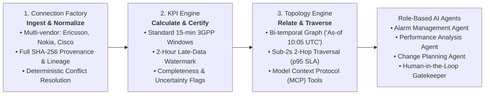
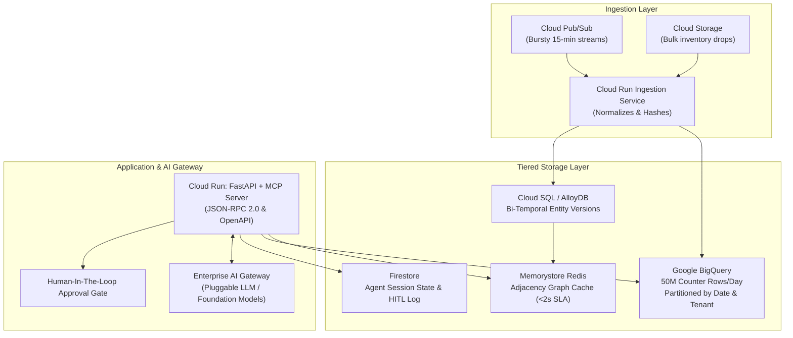

# 06. Executive Presentation: Platform Overview & Incident Resolution

*Telecom Network Intelligence Platform for Role-Based AI Agents*

---

## Slide 1: Platform Vision & The Three Core Capabilities

### Strategic Objective
Transform fragmented multi-vendor telecom operations into a unified, autonomous intelligence platform where role-governed AI agents safely investigate incidents, correlate dependencies, and assist human operators.

### Key Business Outcomes
- **SLA Guarantee**: Sub-2-second 2-hop topology traversals; Sub-30-second complete agent investigations.
- **Strict Data Isolation**: Guaranteed multi-tenant boundaries across 5 independent telco operators.
- **Safety First**: Zero unauthorized production changes via Human-In-The-Loop (HITL) gatekeeping.

---

## Slide 2: End-to-End System Architecture on Google Cloud

### Optimized for a Lean Engineering Team
Serverless where possible (Cloud Run, BigQuery, Pub/Sub, Firestore) to minimize operational maintenance and maximize auto-scaling from 0 to 100 concurrent agent investigations.

---

## Slide 3: Bi-Temporal Topology & Data Quality Verification

### Two Uncompromising Pillars of Truth

#### 1. Bi-Temporal Graph Reconstruction
- Separates **Valid Time** (physical world state) from **System Time** (platform ingestion time).
- Guarantees exact historical answers: *"What was the exact topology at 10:05 UTC when alarms fired?"* even if corrected vendor inventory arrived at 10:45 UTC.

#### 2. Distinguishing Real Outages vs. Missing Telemetry
The KPI Engine attaches a `completeness_score` and `quality_status` to every calculation:

| Metric | Incident Cells (CELL_001..003) | Control Cell (CELL_099) |
| :--- | :---: | :---: |
| **Availability / Health** | 33.33% (Measured Drop) | 66.7% (Apparent Drop) |
| **Telemetry Completeness** | **100% (3/3 Samples Arrived)** | **33% (1/3 Samples Arrived)** |
| **Agent Verdict** | **GENUINE_NETWORK_PROBLEM** | **DATA_GAP_OR_UNCERTAINTY** |
| **Agent Action** | Propose Standby Backhaul Reroute | **Halt & Decline Remediation** |

---

## Slide 4: Governance, Role-Based Access & Model Context Protocol

### Least-Privilege Role Boundaries

| Role | Read Topo | Read KPI | Propose Action | Approve / Execute | Primary Responsibility |
| :--- | :---: | :---: | :---: | :---: | :--- |
| **Alarm Management** | ✅ | ✅ | ✅ | ❌ | Triage alarms, correlate evidence, stage fixes. |
| **Performance Analysis**| ✅ | ✅ | ❌ | ❌ | Analyze long-term degradation and baseline trends. |
| **Change Planning** | ✅ | ✅ | ✅ | ❌ | Simulate blast radius, AI risk scoring & rollback strategy. |
| **Human Operator** | ✅ | ✅ | ✅ | **✅ (HITL)** | Authorize production changes and oversee AI. |

### Model Context Protocol (MCP) Standard
- Clean JSON-RPC 2.0 tool interface allowing LLMs to interact with network systems.
- Hard bounding safeguards: Max 2 hops, max 250 entities, 2-second timeout, token-budgeted payloads.

---

## Slide 5: The 10:05 UTC Incident Resolution & Phased Roadmap

### Incident Walkthrough (Completed in ~13s locally with live Gemini / SLA < 30s)
1. **10:05 UTC Alarm Ingested**: `CELL_001`, `CELL_002`, `CELL_003` down.
2. **Topology Discovery**: Discovers cells map to `NODE_42` and `NODE_43` at `SITE_ALPHA`.
3. **Correlation**: Identifies shared dependency on Cell Site Router `CSR_ALPHA_01` and `LINK_BACKHAUL_09`.
4. **KPI Inspection**: Validates 99.86% packet loss on backhaul; confirms 100% counter completeness.
5. **Remediation Staged**: Proposes reroute to standby microwave link; NOC Human Lead approves. Alarms clear.

### Delivery Plan (4 Iterative Phases)
- **Phase 1 (MVP - Current)**: Core Connection Factory, Bi-temporal Graph, KPI Engine with Quality Scoring, MCP Server, HITL Gate, and Local Demonstration.
- **Phase 2 (Cloud Pilot)**: Deploy on Cloud Run + BigQuery + Cloud SQL + Memorystore; integrate Pub/Sub ingestion.
- **Phase 3 (Enterprise Scale)**: Onboard all 5 customers; automated Golden Evaluation Harness; fine-tuned domain-specific SLM/LLM reasoning models.
- **Phase 4 (Closed-Loop Autonomous Operations)**: Human-supervised automated low-risk change execution.

